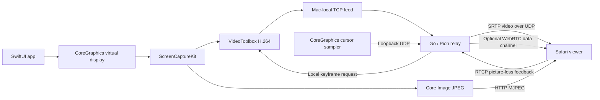

# Extnd architecture

## Objective and scope

Extnd gives a Mac a separate desktop that can be viewed on an iPad over the local network. The priority is responsive pointer movement and window dragging while keeping text readable and setup as simple as scanning a QR code. The Mac owns input and window placement. Safari on the iPad receives and displays the stream.

The initial compatibility target is an iPad mini 3 running iOS 12.5.8. The Mac project targets macOS 14.0 and later and uses Swift 6. Building the bundled relay requires Go 1.25 or later. The reference validation environment is an Apple silicon Mac running macOS 26.6.2, Xcode 27.2, Swift 6.4.2, and Go 1.26.3.

## Session flow

1. The user selects a Mac IPv4 address and streaming mode. The app requests screen-recording access and creates a 1024 × 768 virtual monitor with a 60 Hz display mode. It finds that display in ScreenCaptureKit and verifies that macOS is using it as a separate monitor.
2. The app starts capture and binds a local server to the selected address on an ephemeral port. In MJPEG mode, this server also hosts the viewer. In WebRTC mode, the app launches its bundled relay and passes the capture URL to it.
3. The relay opens the Mac-local H.264 feed, starts its viewer server and registers the viewer URL with the app. The app shows the QR code once the viewer is ready. Safari loads the page and starts the WebRTC connection when the user taps **Start WebRTC**.
4. Stopping the session closes the capture server, stops the relay and capture, and releases the virtual display. Quitting the app ends the session as well.

## Technology and implementation

| Layer | Technology | Responsibility |
| --- | --- | --- |
| App and UI | Swift 6, SwiftUI, AppKit | Session state, network and mode selection, permission feedback, clipboard, and app lifecycle. The interface offers system, light, and dark appearance preferences. |
| Display | Objective-C bridge, private CoreGraphics virtual-display API | Creates the separate monitor and exposes its CoreGraphics display ID to Swift. The bridge resolves the virtual-display classes at runtime. |
| Capture | ScreenCaptureKit, CoreMedia, CoreVideo | Delivers frames and timestamps for the chosen display. Capture uses a queue depth of 3, a 30 or 60 fps target interval, and video-range bi-planar YCbCr in WebRTC modes. |
| H.264 encoding | VideoToolbox | Produces real-time H.264 Baseline Level 3.1 with frame reordering disabled. It requests a frame-delay limit of 0 in the 60 fps profile and 1 in the 30 fps profile where supported. |
| JPEG and QR generation | Core Image | Encodes independent JPEGs for MJPEG, and produces a QR code for the session's viewer URL. |
| Mac-local service | Network.framework | Hosts MJPEG, responds to viewer statistics, and supplies the H.264 feed and relay controls. The H.264 feed and WebRTC control endpoints check that the requester is local and holds the session path. |
| Relay and deployment | Go, Pion WebRTC v4.2.29, Xcode | Packetizes H.264, runs WebRTC signaling, and forwards media and cursor data. A build phase builds the required architectures, embeds the relay in `Extnd.app/Contents/Helpers`, and signs it before the app bundle is signed. |
| Browser | Safari, HTML, CSS, JavaScript, Canvas | Plays the video, displays the optional statistics overlay, draws the experimental cursor when the separate channel is active, and renders the optional picture border separately from the video. |
| Tests | XCTest, Go test and the Go race detector | Cover configuration, encoder output, HTTP behavior, managed relay startup, UDP media, picture-loss feedback, cursor messages, and timing summaries. |

### Video formats and transport

| Mode | Desktop | Capture / encoded output | Delivery |
| --- | --- | --- | --- |
| MJPEG | 1024 × 768 | 1024 × 768, up to 30 fps | Multipart JPEG over a persistent HTTP/TCP connection. Compatibility Mode fetches one JPEG per request. |
| WebRTC 30 fps | 1024 × 768 | 1024 × 768, target 30 fps | H.264 over WebRTC |
| WebRTC 60 fps | 1024 × 768 | 768 × 576, target 60 fps | H.264 over WebRTC |

The WebRTC modes keep the desktop size fixed and change the encoded output. The smaller 60 fps picture reduces the decoder's pixel workload and prioritizes motion. The standard encoder targets 2.0 Mb/s. **Reduce Bitrate Peaks (Experimental)** requests a 1.6 Mb/s average and a 300,000-byte limit over one second (2.4 Mb/s). VideoToolbox reports whether it accepts that setting. A rejected setting falls back to the standard average. Output is measured independently because an accepted setting may still exceed the requested limit.

The App-to-relay TCP feed carries one access unit at a time. An eight-byte big-endian header contains a 32-bit payload length and a 32-bit timestamp at 90 kHz. The H.264 payload uses Annex B start codes, with SPS and PPS on keyframes. Pion packetizes the stream using a 1,150-byte RTP MTU setting and negotiates H.264 with packetization mode 1 and a `42e01f` profile-level ID.

The relay uses host ICE candidates on the selected IPv4 interface. The browser exchanges SDP over HTTP. WebRTC protects media using DTLS-SRTP and sends it over UDP. RTCP picture-loss indications and full intra requests can trigger a new keyframe, with rate limiting on the relay's requests. The sender also requests periodic keyframes at up to 30 encoded frames, approximately 0.5 seconds at 60 fps and 1 second at 30 fps.

The local server keeps the most recent encoded frame and limits each streaming connection to one outstanding send. It can skip independent JPEGs while busy. If the H.264 handoff skips part of a reference sequence, it resumes at a keyframe. This keeps an obsolete backlog from building in the app.

### Experimental fast cursor

The optional cursor path samples the global pointer position at approximately 120 Hz and maps it into the virtual display. Swift sends a nine-byte message over loopback UDP to the relay. It contains flags for visibility and activation, a 32-bit sequence number, and two normalized 16-bit coordinates. The sender emits position or visibility changes and repeats the latest state about every 200 ms.

Pion forwards positions on an unordered WebRTC data channel with zero retransmissions and skips updates when its send buffer grows. Safari rejects out-of-order positions and draws the pointer over the fitted video. The app starts with the cursor included in the video and only switches after the browser confirms that the overlay is ready. Turning off the option on the Mac restores the captured cursor. The overlay currently uses an arrow and the experimental mode supports one viewer at a time.

### Timing and privacy

The optional diagnostics panel reports rolling p50 and p95 over recent samples, up to four seconds. **Capture** is the WindowServer display timestamp to the ScreenCaptureKit callback when metadata is available. **Encode** covers submission to VideoToolbox through preparation of the access unit. **Handoff** covers the encoded frame waiting until submission to the local TCP feed. **Relay** covers RTP packetization and writes after a complete access unit reaches the helper. Safari buffer and decode averages appear when the browser reports the corresponding WebRTC counters. These intervals describe individual stages. An external camera measures the entire motion-to-display path.

Extnd captures the selected virtual display after macOS grants screen-recording permission. The browser URL includes a random per-session token. Signaling and MJPEG use HTTP, so the current build is intended for a trusted LAN. The relay uses local host ICE candidates and sends the video directly between the Mac and iPad. Local builds use ad hoc signing. A new binary can require renewed screen-recording permission, and the private display API may need work after macOS updates.

## What has been validated

| Check | Result |
| --- | --- |
| macOS build and signing | Xcode built the app and embedded relay for arm64 and x86_64. The local app bundle passed signature verification. |
| XCTest | 10 passing tests cover app configuration, the MJPEG stream and controls, VideoToolbox keyframes at 30 and 60 fps, the bitrate profile, relay startup, cursor packet format, and timing summaries. |
| Go WebRTC integration | The race-enabled test passed H.264 RTP delivery over UDP, RTCP picture-loss feedback, and unordered cursor-message delivery. A separate test verified relay timing exposure. |
| WebKit on the Mac | The managed relay displayed synthetic H.264 at 768 × 576 and approximately 60 fps. The setup and active-session layouts were reviewed in light and dark appearances, and the displayed QR code was decoded in a local test. |
| iPad mini 3 | A manual trial on iOS 12.5.8 confirmed that the WebRTC display streamed and felt more responsive than the earlier MJPEG viewer. Sustained 60 fps and end-to-end cursor and window latency remain to be measured on the device. |

The [benchmark tables in the README](README.md#benchmark-results) summarize the Mac results. The [WebRTC testing guide](Experiments/WebRTC/README.md) records the workloads, interpretation and checks for the target iPad.

## Latency roadmap

1. **Establish the physical baseline.** Film the mouse and iPad together at 120 or 240 fps. Record at least 20 runs per condition for pointer movement and window dragging, with the same display profile, network and workload. Compare median and p95 motion-to-display delay, freezes and text clarity.
2. **Qualify the fast cursor.** Compare the overlay on and off while keeping the video profile fixed. A gain around one 60 Hz refresh (17 ms) is a useful target. Check alignment, visibility at display edges, window dragging, and fallback on the device. The video path determines how quickly the dragged window follows the pointer.
3. **Qualify the bitrate profile.** Change only **Reduce Bitrate Peaks (Experimental)**. Compare window-motion p95, receiver loss or buffering when available, and text readability. Keep the profile optional until the iPad trial supports a default change.
4. **Tune the measured bottleneck.** If capture or encoding dominates, consider rejecting old input frames before encoding or testing a smaller 60 fps output. If the network dominates, measure encoder bursts and adapt bitrate conservatively. If the receiver dominates, evaluate an iPad client with control over decoding and presentation before changing the transport or codec.

## References

- [ScreenCaptureKit capture and configuration](https://developer.apple.com/documentation/screencapturekit/capturing-screen-content-in-macos)
- [VideoToolbox data-rate limits](https://developer.apple.com/library/archive/qa/qa1958/_index.html)
- [Pion WebRTC](https://github.com/pion/webrtc)
- [WebRTC statistics](https://www.w3.org/TR/webrtc-stats/)
