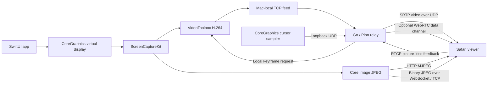

# Extnd architecture

## Objective and scope

Extnd gives a Mac a separate desktop that can be viewed on an iPad over the local network. The priority is responsive pointer movement and window dragging while keeping text readable and setup as simple as scanning a QR code. The Mac owns input and window placement. Safari on the iPad receives and displays the stream.

The initial compatibility target is an iPad mini 3 running iOS 12.5.8. The Mac project targets macOS 14.0 and later and uses Swift 6. Building the bundled relay requires Go 1.25 or later. The reference validation environment is an Apple silicon Mac running macOS 26.6.2, Xcode 27.2, Swift 6.4.2, and Go 1.26.3.

## Session flow

1. The user selects a Mac IPv4 address and streaming mode. The app requests screen-recording access and creates a 1024 × 768 virtual monitor with a 60 Hz display mode. It finds that display in ScreenCaptureKit and verifies that macOS is using it as a separate monitor.
2. The app starts capture and binds a local server to the selected address on an ephemeral port. This server hosts the MJPEG and WebSocket viewers. The WebSocket mode also opens a second port for media. In WebRTC mode, the app launches its bundled relay and passes the capture URL to it.
3. The WebRTC relay opens the Mac-local H.264 feed, starts its viewer server and registers the viewer URL with the app. The app shows the QR code once the selected viewer is ready. Safari starts playing JPEGs when the viewer loads. In WebRTC mode, the user taps **Start WebRTC** to connect.
4. Stopping the session closes the local listeners, stops capture and any running relay, and releases the virtual display. Quitting the app ends the session as well.

## Technology and implementation

| Layer | Technology | Responsibility |
| --- | --- | --- |
| App and UI | Swift 6, SwiftUI, AppKit | Session state, network and mode selection, permission feedback, clipboard, and app lifecycle. The interface offers system, light, and dark appearance preferences. |
| Display | Objective-C bridge, private CoreGraphics virtual-display API | Creates the separate monitor and exposes its CoreGraphics display ID to Swift. The bridge resolves the virtual-display classes at runtime. |
| Capture | ScreenCaptureKit, CoreMedia, CoreVideo | Delivers frames and timestamps for the chosen display. Capture uses a queue depth of 3, a 30 or 60 fps target interval, and video-range bi-planar YCbCr in WebRTC modes. |
| H.264 encoding | VideoToolbox | Produces real-time H.264 Baseline Level 3.1 with frame reordering disabled. It requests a frame-delay limit of 0 in the 60 fps profile and 1 in the 30 fps profile where supported. |
| JPEG and QR generation | Core Image | Encodes independent JPEGs for MJPEG and WebSocket and produces a QR code for the session's viewer URL. |
| Mac-local service | Network.framework | Hosts the JPEG viewers, responds to viewer statistics, and supplies the H.264 feed and relay controls. The H.264 feed and WebRTC control endpoints check that the requester is local and holds the session path. |
| Relay and deployment | Go, Pion WebRTC v4.2.29, Xcode | Packetizes H.264, runs WebRTC signaling, and forwards media and cursor data. A build phase builds the required architectures, embeds the relay in `Extnd.app/Contents/Helpers`, and signs it before the app bundle is signed. |
| Browser | Safari, HTML, CSS, JavaScript, Canvas | Plays the video, displays the optional statistics overlay, and draws the experimental cursor when the separate channel is active. |
| Tests | XCTest, Go test and the Go race detector | Cover configuration, encoder output, HTTP behavior, managed relay startup, UDP media, picture-loss feedback, cursor messages, and timing summaries. |

### Video formats and transport

| Mode | Desktop | Capture / encoded output | Delivery |
| --- | --- | --- | --- |
| MJPEG | 1024 × 768 | 1024 × 768, up to 30 fps | Multipart JPEG over a persistent HTTP/TCP connection. Compatibility Mode fetches one JPEG per request. |
| WebSocket JPEG 60 fps (Experimental) | 1024 × 768 | 1024 × 768, up to 60 fps | Independent binary JPEG messages over WebSocket/TCP on the local network |
| WebRTC 30 fps | 1024 × 768 | 1024 × 768, target 30 fps | H.264 over WebRTC |
| WebRTC 60 fps (768 × 576) | 1024 × 768 | 768 × 576, target 60 fps | H.264 over WebRTC |
| WebRTC 60 fps (704 × 528) | 1024 × 768 | 704 × 528, target 60 fps | H.264 over WebRTC |
| WebRTC 60 fps (640 × 480) | 1024 × 768 | 640 × 480, target 60 fps | H.264 over WebRTC |

The WebRTC modes keep the desktop size fixed and change the encoded output. Compared with 768 × 576, the 704 × 528 mode has about 16% fewer pixels per frame and the 640 × 480 mode has about 31% fewer. All three request the same 60 fps target and encoder settings so the iPad trial can isolate the resolution change. The standard encoder targets 2.0 Mb/s. **Reduce Bitrate Peaks (Experimental)** requests a 1.6 Mb/s average and a 300,000-byte limit over one second (2.4 Mb/s). VideoToolbox reports whether it accepts that setting. A rejected setting falls back to the standard average. Output is measured independently because an accepted setting may still exceed the requested limit.

## Protocol comparison

Extnd captures the same virtual display in every mode. JPEG and H.264 describe how the picture is compressed. HTTP multipart, WebSocket and RTP describe how the resulting bytes are delivered. MJPEG and WebSocket use complete JPEG images that can be decoded independently. H.264 also compresses across frames, improving bandwidth efficiency on many workloads and making recovery from a missing reference frame important.

### MJPEG over HTTP

Safari points an `` at `screen.mjpeg`. A single long-lived HTTP response carries `multipart/x-mixed-replace`, with a boundary, content type and length for each JPEG. The Mac pushes available frames and keeps the latest JPEG, skipping older images when an application send is in progress. **Compatibility Mode** instead requests `frame.jpg` repeatedly and waits 85 ms after each successful image load before requesting another. Both paths run over TCP. [IETF multipart syntax](https://www.rfc-editor.org/rfc/rfc2046.html#section-5.1) · [HTML multipart image processing](https://html.spec.whatwg.org/multipage/images.html#updating-the-image-data)

### JPEG over WebSocket

Safari loads the viewer over HTTP, then connects to a second local port using `ws://`. An HTTP Upgrade handshake establishes the WebSocket connection. Network.framework checks the viewer's `Origin` and the session token, passed as the WebSocket subprotocol. Safari sends the text message `next` when ready for a picture. The Mac replies with the newest available JPEG as a binary message, waiting for a fresh image when the last one was already sent. The browser loads the image from a Blob URL and requests the next JPEG after the load event. [IETF WebSocket protocol](https://www.rfc-editor.org/rfc/rfc6455.html) · [Apple Network.framework WebSocket options](https://developer.apple.com/documentation/network/nwprotocolwebsocket)

This policy limits the queue of old images in the app. Each request still has to travel to the Mac, and the reply needs time for network transfer and browser image loading. Sustaining 60 loaded images per second takes an average cycle of about 16.7 ms. TCP delivers bytes in order, so retransmission of missing data can delay delivery of later bytes in both JPEG modes. Compared with MJPEG, the WebSocket experiment changes delivery, browser image loading and the capture target while keeping the JPEG resolution and compression settings the same. [IETF TCP specification](https://www.rfc-editor.org/rfc/rfc9293.html#section-2.2)

### H.264 over WebRTC

The Mac app sends each VideoToolbox H.264 access unit to the bundled Go/Pion relay over a TCP feed on the Mac. An eight-byte big-endian header contains a 32-bit payload length and a 32-bit timestamp at 90 kHz. The H.264 payload uses Annex B start codes, with SPS and PPS on keyframes. If the H.264 handoff skips part of a reference sequence, it resumes at a keyframe.

Safari and the relay exchange their SDP offer and answer over HTTP. ICE establishes a direct connection using local IPv4 candidates. DTLS establishes the keys for SRTP, and the relay packetizes H.264 into SRTP media sent over UDP. Pion uses a 1,150-byte RTP MTU setting and negotiates H.264 packetization mode 1 with a `42e01f` profile-level ID. The HTTP signaling and Mac-local TCP feed are separate from the media path between devices. [IETF WebRTC transports](https://www.rfc-editor.org/rfc/rfc8835.html) · [IETF H.264 RTP payload format](https://www.rfc-editor.org/rfc/rfc6184.html)

UDP lets later packets reach the browser independently of any lost packet. The viewer may buffer for timing variation, and H.264 decoding can still depend on earlier frames. RTCP picture-loss indications and full intra requests can trigger a new keyframe, with rate limiting on the relay's requests. The encoder also requests periodic keyframes at up to 30 encoded frames, approximately 0.5 seconds at 60 fps and 1 second at 30 fps. [IETF WebRTC media transport and feedback](https://www.rfc-editor.org/rfc/rfc8834.html)

### Reading FPS and Wi-Fi results

The capture target is the rate requested from ScreenCaptureKit. The WebSocket viewer's decoded FPS counts JPEG image loads, and WebRTC uses receiver decode counters when Safari exposes them. MJPEG can report source encoding FPS through the app's statistics endpoint. These readings measure different stages. A camera recording of window motion measures visible end-to-end response. [W3C WebRTC statistics](https://www.w3.org/TR/webrtc-stats/)

Media travels within the local network. Link signal, contention, retransmission and receiver processing can affect the result. The iPad mini 3 supports both 2.4 GHz and 5 GHz Wi-Fi. The reported WebSocket trial used 5 GHz Wi-Fi. A controlled comparison across bands would be needed to quantify its effect. [Apple iPad mini 3 specifications](https://support.apple.com/en-us/112018)

### Experimental fast cursor

The optional cursor path samples the global pointer position at approximately 120 Hz and maps it into the virtual display. Swift sends a nine-byte message over loopback UDP to the relay. It contains flags for visibility and activation, a 32-bit sequence number, and two normalized 16-bit coordinates. The sender emits position or visibility changes and repeats the latest state about every 200 ms.

Pion forwards positions on an unordered WebRTC data channel with zero retransmissions and skips updates when its send buffer grows. Safari rejects out-of-order positions and draws the pointer over the fitted video. The app starts with the cursor included in the video and only switches after the browser confirms that the overlay is ready. Turning off the option on the Mac restores the captured cursor. The overlay currently uses an arrow and the experimental mode supports one viewer at a time.

### Timing and privacy

The optional diagnostics panel reports rolling p50 and p95 over recent samples, up to four seconds. **Capture** is the WindowServer display timestamp to the ScreenCaptureKit callback when metadata is available. **Encode** covers submission to VideoToolbox through preparation of the access unit. **Handoff** covers the encoded frame waiting until submission to the local TCP feed. **Relay** covers RTP packetization and writes after a complete access unit reaches the helper. Safari buffer and decode averages appear when the browser reports the corresponding WebRTC counters. These intervals describe individual stages. An external camera measures the entire motion-to-display path.

Extnd captures the selected virtual display after macOS grants screen-recording permission. The browser URL includes a random per-session token. Signaling, MJPEG and the experimental WebSocket mode operate over unencrypted local connections, so the current build is intended for a trusted LAN. The WebRTC relay uses local host ICE candidates and sends encrypted video directly between the Mac and iPad. Local builds use ad hoc signing. A new binary can require renewed screen-recording permission, and the private display API may need work after macOS updates.

## What has been validated

| Check | Result |
| --- | --- |
| macOS build and signing | Xcode built the app and embedded relay for arm64 and x86_64. The local app bundle passed signature verification. |
| XCTest | All 15 tests passed. They cover app configuration, MJPEG and WebSocket JPEG delivery, 1024 × 768 at 60 fps for WebSocket, VideoToolbox keyframes in each WebRTC mode, the bitrate profile, relay startup, cursor packet format, and timing summaries. |
| Go WebRTC integration | The race-enabled test passed H.264 RTP delivery over UDP, RTCP picture-loss feedback, and unordered cursor-message delivery. A separate test verified relay timing exposure. |
| WebKit on the Mac | In separate synthetic tests, WebKit played H.264 over WebRTC at 768 × 576, 704 × 528 and 640 × 480 at approximately 60 fps. The WebSocket viewer displayed synthetic JPEGs at 1024 × 768, reporting approximately 30 fps at the 30 fps feed rate and 37–61 decoded fps across three samples at the 60 fps feed rate. The setup and active-session layouts were reviewed in light and dark appearances, and the displayed QR code was decoded in a local test. |
| iPad mini 3 | On iOS 12.5.8, WebRTC felt more responsive than MJPEG. A later manual comparison reported smoother motion at 640 × 480 than at 768 × 576, with reduced sharpness and playback below the 60 fps target. The WebSocket trials reported good image quality. With the 60 fps WebSocket build on 5 GHz Wi-Fi, the tester observed playback below 30 fps. Exact sustained FPS and end-to-end latency remain to be measured. |

The [benchmark tables in the README](README.md#benchmark-results) summarize the Mac results. The [WebRTC testing guide](Experiments/WebRTC/README.md) records the workloads, interpretation and checks for the target iPad.

## Related implementations

| Project | Approach and relevance to Extnd |
| --- | --- |
| Deskreen | Uses WebRTC to stream a desktop to a browser. It is the closest comparison for keeping the iPad viewer accessible without a native app. [Deskreen CE](https://github.com/pavlobu/deskreen) |
| Weylus | Sends H.264 inside fragmented MP4 over WebSocket and plays it with Media Source Extensions. WebKit added that API on iPad with Safari 13, which puts this playback path outside the target iPad's iOS 12 environment. [Weylus architecture](https://github.com/H-M-H/Weylus/blob/master/Readme.md#how-does-this-work) · [WebKit on Safari 13](https://webkit.org/blog/9674/new-webkit-features-in-safari-13/) |
| Sunshine and Moonlight | Sunshine supports ScreenCaptureKit and VideoToolbox on macOS. Moonlight's iOS renderer uses AVSampleBufferDisplayLayer and can retain one queued frame to smooth timing variation. The App Store lists iOS 12 support, so this pair could provide a native benchmark on the target hardware if installation and playback succeed. [Sunshine capabilities](https://docs.lizardbyte.dev/projects/sunshine/latest/) · [Moonlight renderer](https://github.com/moonlight-stream/moonlight-ios/blob/master/Limelight/Stream/VideoDecoderRenderer.m) · [Moonlight on the App Store](https://apps.apple.com/us/app/moonlight-game-streaming/id1000551566?platform=ipad) |
| MegaDisplay | Streams H.264 from Linux to an Android tablet over USB. Its choice of a wired link suggests a way to isolate Wi-Fi variability, though its implementation targets different platforms. [MegaDisplay](https://github.com/linuxnoodle/megadisplay) |

## Latency roadmap

1. **Establish the physical baseline.** Film the mouse and iPad together at 120 or 240 fps. Record at least 20 runs per condition for pointer movement and window dragging, with the same display profile, network and workload. Compare median and p95 motion-to-display delay, freezes and text clarity.
2. **Qualify the fast cursor.** Compare the overlay on and off while keeping the video profile fixed. A gain around one 60 Hz refresh (17 ms) is a useful target. Check alignment, visibility at display edges, window dragging, and fallback on the device. The video path determines how quickly the dragged window follows the pointer.
3. **Qualify the bitrate profile.** Change only **Reduce Bitrate Peaks (Experimental)**. Compare window-motion p95, receiver loss or buffering when available, and text readability. Keep the profile optional until the iPad trial supports a default change.
4. **Find a resolution and frame rate for the iPad mini 3.** Compare 704 × 528 at 60 fps with the 768 × 576 and 640 × 480 WebRTC profiles to test an intermediate level of sharpness. Test 768 × 576 at 30 fps as a separate comparison that changes only the frame-rate target. Use the same cursor, bitrate and network settings. Compare visible window-motion delay, stalls and text clarity.
5. **Tune the measured bottleneck.** If capture or encoding dominates, consider rejecting old input frames before encoding. If loss and buffering rise during motion, test the existing bitrate peak limit at a fixed resolution. Evaluate adaptive resolution only after reproducible fixed-profile results, including whether Safari on iOS 12 can handle a resolution change within a session.
6. **Benchmark native playback before building an iPad app.** If the App Store client runs on the iPad, compare Moonlight and Safari at the same resolution and frame-rate target on the same network. Any gap reflects differences across the two streaming pipelines. A controlled prototype could then hold more of the sender path fixed. Xcode 27.2 lists iOS and iPadOS 15 as its minimum deployment target, so a custom client for iOS 12 needs a separately verified build and installation path. [Apple's Xcode requirements](https://developer.apple.com/xcode/system-requirements/)

## References

- [ScreenCaptureKit capture and configuration](https://developer.apple.com/documentation/screencapturekit/capturing-screen-content-in-macos)
- [VideoToolbox data-rate limits](https://developer.apple.com/library/archive/qa/qa1958/_index.html)
- [Pion WebRTC](https://github.com/pion/webrtc)
- [WebRTC statistics](https://www.w3.org/TR/webrtc-stats/)
